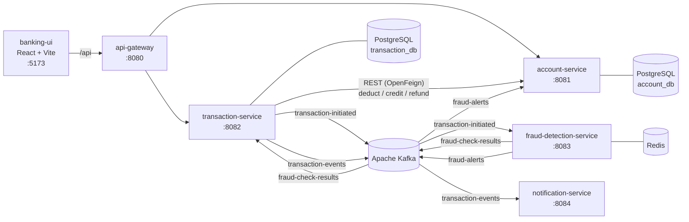
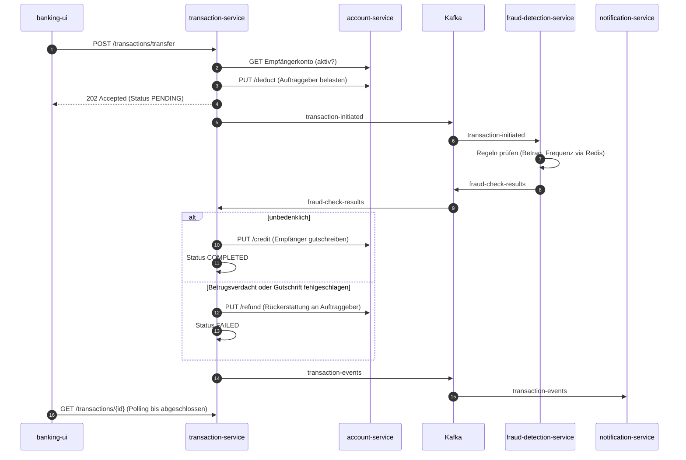

# Banking System – Microservices mit Spring Boot, Kafka & React

Ein Online-Banking-System auf Basis einer **Microservice-Architektur**. Kunden können Konten eröffnen, Kontostände und Umsätze abfragen und Überweisungen ausführen. Jede Überweisung durchläuft eine **SAGA** über mehrere Services: Abbuchung, Betrugsprüfung, Gutschrift bzw. Rückerstattung. Die Services kommunizieren synchron über REST (OpenFeign) und asynchron über **Apache Kafka**.


---

## Inhalt

- [Funktionen](#funktionen)
- [Architektur](#architektur)
- [Technologien](#technologien)
- [Datenbanken & Datenhaltung](#datenbanken--datenhaltung)
- [Services im Überblick](#services-im-überblick)
- [Ablauf einer Überweisung (SAGA)](#ablauf-einer-überweisung-saga)
- [Projekt starten](#projekt-starten)
- [REST-API](#rest-api)
- [Tests](#tests)
- [Projektstruktur](#projektstruktur)
- [Bekannte Einschränkungen & nächste Schritte](#bekannte-einschränkungen--nächste-schritte)

---

## Funktionen

- **Konto eröffnen**: Sparkonto, Girokonto oder Festgeldkonto mit eindeutiger 12-stelliger Kontonummer
- **Kontoabfrage**: Kontostand, Status, Tageslimit und Kontoumsätze
- **Überweisungen** als verteilte Transaktion (SAGA) mit automatischer **Rückerstattung** im Fehlerfall
- **Tageslimit** pro Konto (Sparkonto 100.000 €, Giro-/Festgeldkonto 200.000 €), täglich zurückgesetzt
- **Betrugserkennung**:
  - Einzelüberweisung über 50.000 € wird abgelehnt
  - Mehr als 5 Überweisungen pro Minute (Zähler in Redis) werden abgelehnt, das Konto wird **automatisch gesperrt**
- **Benachrichtigungen** über das Ergebnis jeder Überweisung
- **Sicherheit am Gateway**: interne SAGA-Endpunkte (`/deduct`, `/credit`, `/refund`) sind von außen gesperrt (HTTP 403)
- **Parallelitätsschutz**: Kontostandsänderungen laufen mit Zeilensperre (`PESSIMISTIC_WRITE`), gleichzeitige Buchungen können den Kontostand nicht verfälschen
- **Web-Oberfläche** (React, Deutsch) mit Live-Statusverfolgung der Überweisung

---

## Architektur



Jeder Service hat seine **eigene Datenbank** (Database-per-Service). Kein Service greift direkt auf die Daten eines anderen zu.

---

## Technologien

### Backend

| Bereich | Technologie |
|---|---|
| Sprache | **Java 25** |
| Framework | **Spring Boot 4.1.1** (Spring Web MVC, Spring Data JPA, Bean Validation, Actuator) |
| Microservice-Infrastruktur | **Spring Cloud 2025.1.3**: Spring Cloud Gateway (Server WebMVC), Spring Cloud OpenFeign |
| Messaging | **Apache Kafka 4.1** (KRaft-Modus, ohne ZooKeeper) mit Spring for Apache Kafka, JSON-Serialisierung über Jackson |
| ORM | Hibernate (JPA) |
| Hilfsbibliotheken | Lombok |
| Fehlerbehandlung | RFC-7807 `ProblemDetail` über `@RestControllerAdvice` |
| Build | Maven (Maven Wrapper in jedem Service) |
| Tests | JUnit 5, Mockito, AssertJ |

### Frontend

| Bereich | Technologie |
|---|---|
| Framework | **React 19** mit **TypeScript 6** |
| Build-Tool | **Vite 8** (inkl. Proxy zum API-Gateway) |
| Styling | **Tailwind CSS 4** |
| Linting | ESLint 10 (inkl. `react-hooks`) |

### Infrastruktur

| Komponente | Technologie |
|---|---|
| Container | **Docker / Docker Compose** |
| Relationale Datenbank | **PostgreSQL 17** |
| In-Memory-Datenspeicher | **Redis 8** |
| Message Broker | **Apache Kafka 4.1** |

---

## Datenbanken & Datenhaltung

| Datenbank | Typ | Verwendet von | Inhalt |
|---|---|---|---|
| `account_db` | PostgreSQL 17 | account-service | Tabelle `accounts`: Kontonummer, Inhaber, Kontoart, Status, Kontostand, Tageslimit und Tagesumsatz |
| `transaction_db` | PostgreSQL 17 | transaction-service | Tabelle `transactions`: Auftraggeber, Empfänger, Betrag, Status (`PENDING` / `COMPLETED` / `FAILED`), Fehlergrund |
| `payment_db` | PostgreSQL 17 | payment-service | (noch nicht genutzt) |
| Redis | Key-Value-Store | fraud-detection-service | Zähler `fraud:velocity:{kontonummer}` mit TTL von 60 s für die Erkennung zu vieler Überweisungen |
| Kafka-Topics | Event-Log | alle Services | `transaction-initiated`, `fraud-check-results`, `fraud-alerts`, `transaction-events` |

Das Datenbankschema wird beim Start von Hibernate erzeugt (`ddl-auto: update`). Geldbeträge werden als `DECIMAL(15,2)` (`BigDecimal`) gespeichert, nie als Gleitkommazahl.

---

## Services im Überblick

| Service | Port | Aufgabe |
|---|---|---|
| **api-gateway** | 8080 | Einziger Einstiegspunkt für Clients, Routing zu den Services, Sperre interner Endpunkte |
| **account-service** | 8081 | Kontoverwaltung, Kontostand, Tageslimit, Abbuchung / Gutschrift / Rückerstattung, sperrt Konten bei Betrugsalarm |
| **transaction-service** | 8082 | Überweisungen, SAGA-Orchestrierung, Transaktionshistorie |
| **fraud-detection-service** | 8083 | Regelbasierte Betrugserkennung (Betragsgrenze, Überweisungsfrequenz via Redis) |
| **notification-service** | 8084 | Benachrichtigungen über abgeschlossene/fehlgeschlagene Überweisungen (derzeit als Log-Ausgabe) |
| **payment-service** | 8085 | Grundgerüst für zukünftige Zahlungsfunktionen |
| **banking-ui** | 5173 | Web-Oberfläche (React) |

---

## Ablauf einer Überweisung (SAGA)



**Robustheit:**

- **Idempotenz**: Ein Betrugsergebnis wird nur verarbeitet, solange die Transaktion `PENDING` ist. Doppelt zugestellte Kafka-Nachrichten haben keine Wirkung.
- **Wiederholungen**: Ist der account-service vorübergehend nicht erreichbar, wird die Nachricht bis zu 10-mal im Abstand von 5 s erneut verarbeitet.
- **Kompensation**: Kann das Event nach der Abbuchung nicht an Kafka gesendet werden, wird der Betrag sofort zurückerstattet.

---

## Projekt starten

### Voraussetzungen

- **JDK 25**
- **Docker Desktop**
- **Node.js** (für die Web-Oberfläche, getestet mit Node 24)

### 1. Infrastruktur starten (PostgreSQL, Kafka, Redis)

```bash
docker compose up -d
```

> PostgreSQL läuft auf dem Host-Port **5433**, damit es nicht mit einer lokal installierten PostgreSQL-Instanz auf Port 5432 kollidiert. Die Datenbanken `account_db`, `transaction_db` und `payment_db` werden beim ersten Start automatisch angelegt (`docker/postgres/init.sql`).

### 2. Services starten

Jeden Service in einem eigenen Terminal starten (oder direkt aus der IDE):

```bash
cd account-service          && ./mvnw spring-boot:run
cd transaction-service      && ./mvnw spring-boot:run
cd fraud-detection-service  && ./mvnw spring-boot:run
cd notification-service     && ./mvnw spring-boot:run
cd api-gateway              && ./mvnw spring-boot:run
```

Unter Windows (PowerShell / CMD) `mvnw.cmd spring-boot:run` verwenden.

### 3. Web-Oberfläche starten

```bash
cd banking-ui
npm install
npm run dev
```

Anschließend **http://localhost:5173** öffnen.

### Konfiguration

Alle Verbindungsdaten haben Standardwerte für die lokale Entwicklung und können über Umgebungsvariablen überschrieben werden:

| Variable | Standardwert |
|---|---|
| `DB_URL` | `jdbc:postgresql://localhost:5433/<service>_db` |
| `DB_USERNAME` / `DB_PASSWORD` | `postgres` / `postgres` |
| `KAFKA_BOOTSTRAP_SERVERS` | `localhost:9092` |
| `REDIS_HOST` / `REDIS_PORT` | `localhost` / `6379` |
| `ACCOUNT_SERVICE_URL` | `http://localhost:8081` |
| `TRANSACTION_SERVICE_URL` | `http://localhost:8082` |

Die Schwellenwerte der Betrugserkennung stehen in `fraud-detection-service/src/main/resources/application.yaml` (`app.fraud.*`).

> ⚠️ Die Standardpasswörter sind nur für die lokale Entwicklung gedacht. In einer produktiven Umgebung müssen sie über Umgebungsvariablen bzw. einen Secret-Store gesetzt werden.

---

## REST-API

Alle Aufrufe laufen über das API-Gateway (`http://localhost:8080`).

### Konten

| Methode | Endpunkt | Beschreibung |
|---|---|---|
| `POST` | `/api/v1/accounts` | Konto eröffnen |
| `GET` | `/api/v1/accounts/{accountNumber}` | Kontodetails |
| `GET` | `/api/v1/accounts/{accountNumber}/balance` | Kontostand |
| `PUT` | `/api/v1/accounts/{accountNumber}/block` | Konto sperren |

### Überweisungen

| Methode | Endpunkt | Beschreibung |
|---|---|---|
| `POST` | `/api/v1/transactions/transfer` | Überweisung starten (Antwort `202`, Status `PENDING`) |
| `GET` | `/api/v1/transactions/{transactionId}` | Status einer Überweisung |
| `GET` | `/api/v1/transactions/account/{accountNumber}` | Umsätze eines Kontos |

**Beispiel: Konto eröffnen**

```bash
curl -X POST http://localhost:8080/api/v1/accounts \
  -H "Content-Type: application/json" \
  -d '{
        "accountHolderName": "Max Mustermann",
        "email": "max@example.de",
        "phone": "015112345678",
        "accountType": "CURRENT",
        "initialDeposit": 5000
      }'
```

**Beispiel: Überweisung**

```bash
curl -X POST http://localhost:8080/api/v1/transactions/transfer \
  -H "Content-Type: application/json" \
  -d '{ "fromAccountNumber": "123456789012", "toAccountNumber": "210987654321", "amount": 250.00 }'
```

**Fehlerantworten** folgen dem Standard RFC 7807 (`ProblemDetail`):

```json
{
  "status": 422,
  "title": "Unprocessable Content",
  "detail": "Unzureichende Deckung auf Konto 123456789012"
}
```

Eine vollständige Testsammlung aller Szenarien liegt in [`api-tests.http`](api-tests.http). Sie lässt sich direkt in IntelliJ IDEA ausführen.

---

## Tests

```bash
cd account-service      && ./mvnw test -Dtest=AccountServiceTest
cd transaction-service  && ./mvnw test -Dtest=TransactionServiceTest
```

Die Unit-Tests decken unter anderem ab:

- Abbuchung, Tageslimit (inkl. Zurücksetzen am nächsten Tag), unzureichende Deckung, gesperrte Konten
- Rückerstattung inkl. Freigabe des verbrauchten Tageslimits
- alle Zweige der SAGA: erfolgreiche Gutschrift, Betrugsverdacht, fehlgeschlagene Gutschrift, doppelte Kafka-Nachricht

> Die `contextLoads`-Tests der einzelnen Services benötigen die laufende Docker-Infrastruktur.

---

## Projektstruktur

```
banking-system/
├── api-gateway/               # Spring Cloud Gateway (WebMVC)
├── account-service/           # Konten, Kontostand, Tageslimit
├── transaction-service/       # Überweisungen & SAGA-Orchestrierung
├── fraud-detection-service/   # Betrugserkennung (Kafka + Redis)
├── notification-service/      # Benachrichtigungen (Kafka)
├── payment-service/           # Grundgerüst
├── banking-ui/                # React-Frontend (Vite, TypeScript, Tailwind)
├── docker/postgres/init.sql   # legt die Datenbanken an
├── docker-compose.yml         # PostgreSQL, Kafka, Redis
└── api-tests.http             # HTTP-Testsammlung (IntelliJ)
```

Jeder Spring-Boot-Service folgt derselben Schichtung: `controller`, `services`, `repositories`, `entity`, `dtos`, `events`, `exceptions`.

---

## Bekannte Einschränkungen & nächste Schritte

- **Keine Authentifizierung**: Wer eine Kontonummer kennt, kann davon überweisen. Nächster Schritt: Spring Security mit JWT / OAuth2 (z. B. Keycloak).
- **Benachrichtigungen** werden derzeit nur geloggt. E-Mail-Versand ist vorbereitet (`spring-boot-starter-mail`).
- **Transactional Outbox**: Zwischen Datenbank-Commit und Kafka-Versand gibt es keine atomare Garantie. Das Outbox-Pattern würde dies absichern.
- **payment-service** ist bisher nur ein Grundgerüst.
- **Service Discovery** (z. B. Eureka) und **Containerisierung der Services** (Dockerfiles) fehlen noch. Die Service-Adressen sind konfigurierbar.
